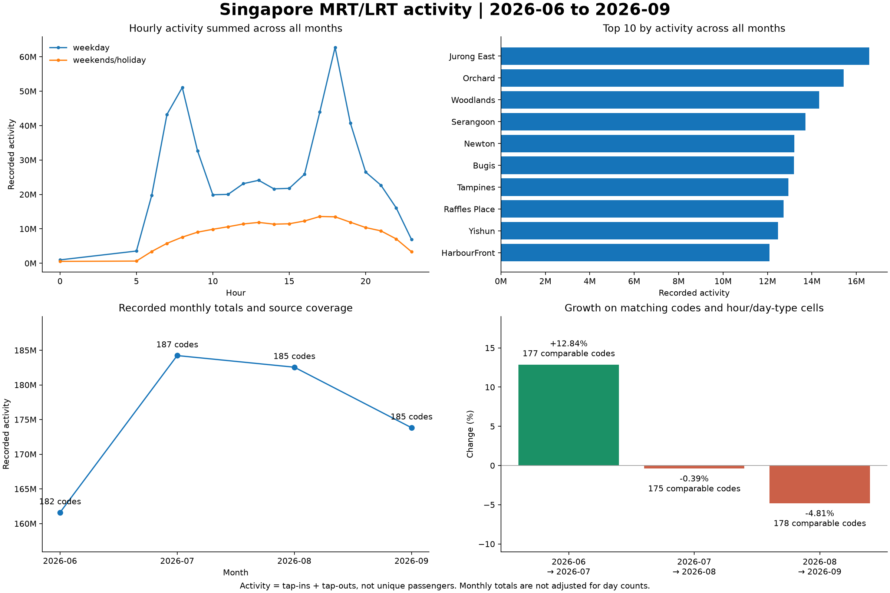
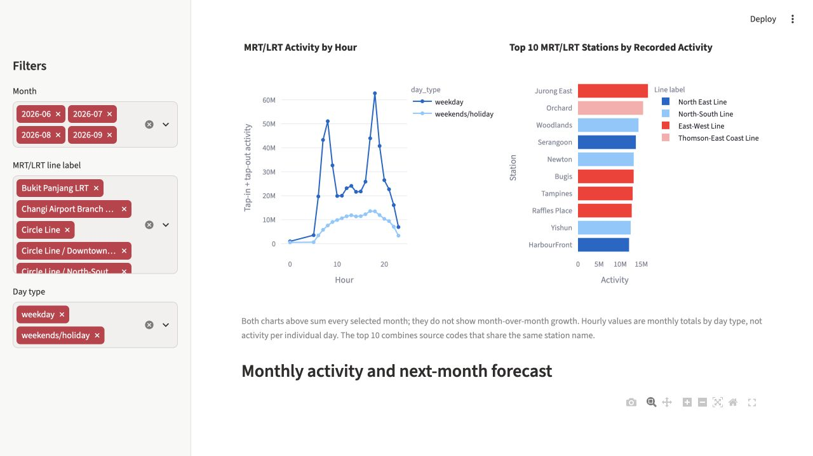
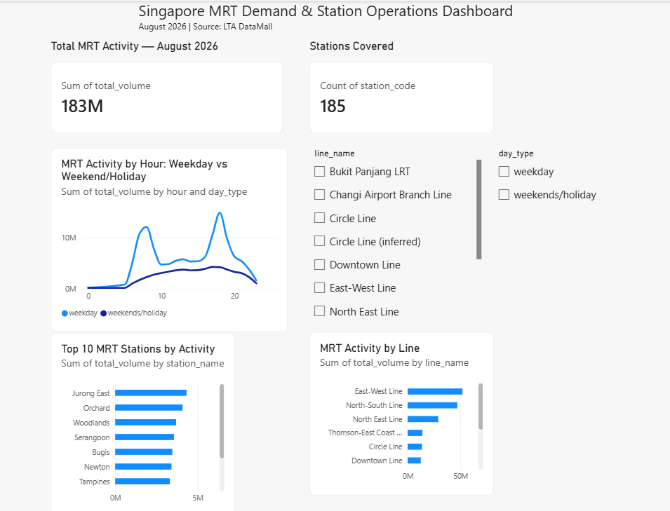
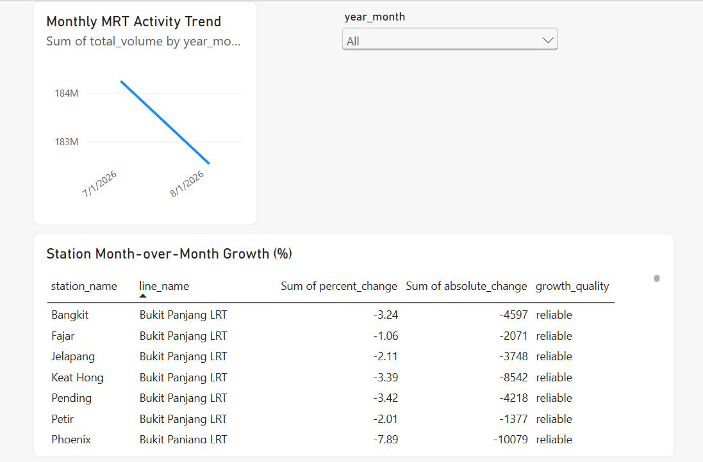

# Singapore MRT Demand & Station Operations Analytics

Analyse LTA MRT/LRT station activity with Python, SQL, Power BI and Streamlit to identify high-volume stations, peak hours and locations to prioritise for operational review.

[GitHub repository](https://github.com/ngcanhh/Repository-name-mrt-demand-analytics) · [Live Streamlit app](https://repository-name-mrt-demand-analytics-kaxxjaulszrvzwrrkdat6s.streamlit.app/) · [Operational case study](docs/operations-case-study.md) · [CV description](docs/cv-bullets.md) · [Python source](src/) · [SQL queries](sql/mrt_business_queries.sql)

## Four month analysis

The June–September 2026 snapshot contains **29,468 records and 187 distinct MRT/LRT station codes**. Activity is the sum of tap-ins and tap-outs, not unique passengers or platform occupancy.

- Jurong East, Orchard, Woodlands, Serangoon and Newton account for **10.43% of recorded activity** across all four months. They form a transparent shortlist for a first operational review.
- The network weekday peak is **18:00–19:00 in each of the four months**; the weekend/holiday peak is **17:00–18:00 in each month**.
- On matching station codes and hour/day-type coverage, monthly activity changes are **+12.84%, −0.39% and −4.81%** for June→July, July→August and August→September. Each pair uses its own comparable cohort.

The [case study](docs/operations-case-study.md) connects these findings to proposed review windows and explains the calculation limits. These findings prioritise further investigation; they do not demonstrate a staffing shortage, cost savings or adoption by an operator.



## How the app uses selected months

| App section | When all four months are selected |
| --- | --- |
| Total activity and station-code KPI | Sum activity across all four months; count distinct source codes in that scope |
| MRT/LRT Activity by Hour | Sum activity at each hour across all four months, split by day type |
| Top 10 stations | Rank combined four-month activity; combine codes sharing a station name |
| Monthly trend | Show June, July, August and September separately |
| Monthly coverage and comparable growth | Show coverage for all four months and all three consecutive monthly comparisons |
| Monthly station movements | Default to August→September; allow selecting June→July or July→August |
| Stations and hours to review | Use all four months to rank five stations and identify their weekday peak hour |

All sections recalculate for the selected month, line labels and day types. The two overview charts are period totals, not month-over-month comparisons or average daily activity. Line labels are metadata labels; interchange activity is not divided among individual lines.

Growth uses the **same Python function in the app and CSV exports**. A code must appear in both months with the same observed `(day_type, hour)` cells. Excluded codes and reasons remain in the exported station table. Missing data is not filled with zero; zero baselines have no percentage growth. Months separated by a gap are not labelled month-over-month comparisons.

The monthly chart retains an exploratory one-month-ahead linear baseline when at least three consecutive months are selected. Actuals and the baseline use the same selected scope. Four months do not support a validated operational forecasting model.

### Streamlit preview with all four months selected



## Run locally

Use Python 3.12 from the repository root:

```bash
python -m venv .venv
source .venv/bin/activate
python -m pip install -r requirements.txt
python -m streamlit run app.py
```

On Windows, activate with `.venv\Scripts\Activate.ps1` instead. The checked-in processed CSV is sufficient to run the app and rebuild the analysis without an API key.

Rebuild evidence and run checks:

```bash
python src/validate_monthly_data.py
python src/analyze_monthly_growth.py
python src/build_operations_case_study.py
python -m unittest discover -s tests -v
```

The case study prose and CV metrics describe the June–September 2026 snapshot. When extending the dataset, regenerate the outputs and refresh those written numbers before sharing them. The live app reflects the source deployed on Streamlit; local changes appear there after publication.

## Data and outputs

Source: **LTA DataMall, Passenger Volume by Train Stations**. Each processed row records a month, source station code, hour and day type, with tap-in and tap-out volume. Some station codes share a name; 187 codes must not be interpreted as 187 unique physical stations.

The [data-quality report](outputs/tables/data_quality_report.csv) records scope and validation status. Validation checks required columns, missing critical/numeric values, nonnegative volumes, valid hours, duplicate record keys and `total_volume = tap_in_volume + tap_out_volume`.

| Output | Purpose |
| --- | --- |
| [Monthly coverage](outputs/tables/monthly_coverage.csv) | Recorded codes, rows and total activity per month |
| [Monthly comparisons](outputs/tables/monthly_comparison_summary.csv) | Comparable totals, growth and excluded-code counts for each consecutive pair |
| [Station movements](outputs/tables/station_monthly_growth.csv) | Every pair and code, including exclusions and zero-baseline flags |
| [Review priorities](outputs/tables/operations_review_priorities.csv) | Five-station shortlist with peak hours and concentration |
| [Hourly summary](outputs/tables/multi_month_hourly_summary.csv) | All-month hourly totals by day type |
| [Station summary](outputs/tables/multi_month_station_summary.csv) | All-month station-name totals and contributing codes |

The app also exports filtered source rows, monthly comparison summaries and the selected pair's station movements. SQL/DuckDB queries cover monthly totals, peak hours, latest-month rankings and comparable monthly movement by line label.

## Power BI dashboard

The [Power BI file](dashboard/MRT_Demand_Analytics.pbix) includes activity KPIs, hourly patterns, top stations and activity by line, with line and day-type filters. The comparable-growth improvements described above are implemented in Python/Streamlit and the exported CSV tables.

### August 2026 Power BI snapshot



### Power BI monthly trends preview



## Automated monthly updates

The [GitHub Actions workflow](.github/workflows/monthly-update.yml) runs on the 15th at 02:00 UTC / 10:00 Singapore time, targeting the previous calendar month, and also supports manual runs. Set the repository secret `LTA_ACCOUNT_KEY` to enable downloads. The pipeline combines available raw files, enriches metadata, validates data, builds all consecutive monthly comparisons and an exploratory baseline, runs tests and commits processed data and output tables.

If the download is unavailable or fails, the current pipeline retains existing processed coverage and can still exit successfully. A green workflow alone therefore does not prove that a month was added; check monthly coverage. Rebuilds preserve previously processed months when their raw downloads are absent locally. Raw files, where available, replace the corresponding processed month in full. Historical files outside LTA's download window may require a separate archive.

## Project structure

```text
app.py       Streamlit application
src/         Download, cleaning, validation, shared comparisons and review calculations
sql/         DuckDB business queries
tests/       Data invariants and comparison/filter regression tests
data/        Raw inputs, station reference files and processed CSVs
outputs/     Analysis tables, figures and the baseline forecast
dashboard/   Power BI dashboard
docs/        Operational case study and CV description
```

## Interpretation limits

- Four months are not a full year and do not establish seasonality or explain why demand changes.
- Comparable codes and cells reduce coverage mismatches; they do not guarantee complete source reporting or resolve station-code changes.
- Monthly totals are not adjusted for month length or weekday, weekend and public-holiday counts. Weekday/weekend totals do not measure demand per individual day.
- Activity measures station entries/exits, not unique passengers, crowding, waiting time, staffing need or train capacity utilisation.
- Station metadata includes legacy mappings and explicit overrides. Line labels should not be interpreted as a precise allocation of interchange flows.

Future work: extend the historical window, examine daily-normalised demand when calendar definitions are verified, and validate any forecast against held-out months before using it for planning.
