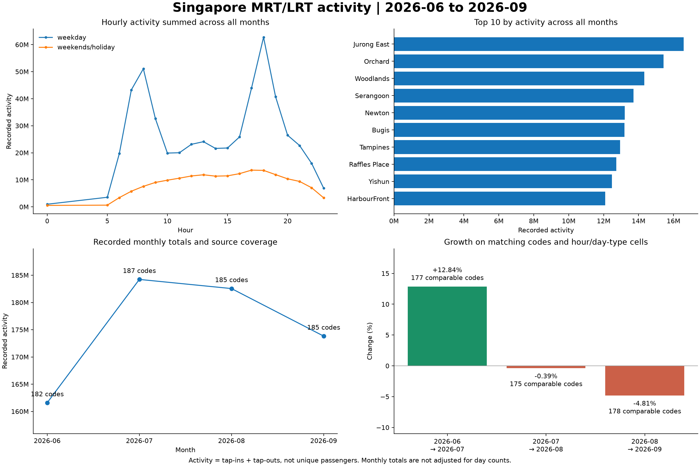

# Prioritising MRT and LRT station reviews

For a first operational review, prioritise Jurong East, Orchard, Woodlands, Serangoon and Newton around 18:00–19:00 on weekdays. Across the June–September 2026 snapshot, these five named stations account for 10.43% of recorded tap-in plus tap-out activity. Their volume makes them useful places to investigate queue conditions and passenger flows; it does not establish a staffing shortage.

## Decision and scope

The question is: **if an operations analyst can initially review five stations, which stations and hours should they examine?** Rank stations by recorded activity across all four months, then identify the highest-activity weekday hour for each shortlisted station. This is a transparent descriptive shortlist, rather than a staffing allocation model.

The snapshot contains **29,468 station-hour/day-type records, 187 distinct source station codes and four months of MRT/LRT data**. Codes sharing a station name are combined for the shortlist. Activity means tap-ins plus tap-outs, not unique passengers, platform occupancy or train loads. A station's four-month total is not an average day.

## Findings across all four months

1. **Five stations account for 73,233,866 activity, or 10.43% of the recorded total.** Jurong East leads with 16,575,822, followed by Orchard with 15,424,515 and Woodlands with 14,325,219. All five shortlisted stations have records in each of the four months. This concentrates the initial review on high-volume locations.
2. **The weekday peak is 18:00–19:00 in every month; the weekend/holiday peak is 17:00–18:00 in every month.** The combined weekday 18:00 hour accounts for 62,732,790 activity, or 11.90% of all weekday activity in the snapshot. At Jurong East, that hour accounts for 14.00% of its weekday activity. Review windows can therefore differ by day type.
3. **September activity falls 4.81% against August on 178 comparable codes.** June→July is +12.84% on 177 codes; July→August is −0.39% on 175 codes. The comparable cohort changes by pair, so these percentages are not one fixed-cohort index. These are monthly volume changes, not evidence of a change in average daily demand or its cause.

## Initial review shortlist

| Priority | Station | Four-month recorded activity | Weekday review window | Share of station weekday activity in that hour |
| --- | --- | ---: | --- | ---: |
| 1 | Jurong East | 16,575,822 | 18:00–19:00 | 14.0% |
| 2 | Orchard | 15,424,515 | 18:00–19:00 | 11.2% |
| 3 | Woodlands | 14,325,219 | 18:00–19:00 | 11.8% |
| 4 | Serangoon | 13,704,502 | 18:00–19:00 | 12.0% |
| 5 | Newton | 13,203,808 | 18:00–19:00 | 12.4% |

Observe queues, gateline throughput, interchange flows and incidents during these windows, then compare those observations with local staffing and service conditions. Use the month-pair selector to investigate unusual station-code movements separately. For weekend/holiday reviews, start by examining the network's 17:00–18:00 peak and confirm the individual station profile before scheduling a visit.

## Comparable monthly growth

A pair is eligible only when the selected months are consecutive calendar months. Within each pair, include a code only if it appears in both months with exactly the same observed `(day_type, hour)` cells. Never replace missing records with zero. Retain excluded codes and reasons in the station movement export; a zero baseline has no percentage growth. A recorded zero in the later month can still represent a valid −100% change when coverage matches.

| Comparison | Codes recorded before → after | Codes in both months | Codes with matching hour/day-type coverage | Comparable activity change |
| --- | --- | ---: | ---: | ---: |
| June → July 2026 | 182 → 187 | 182 | 177 | +12.84% |
| July → August 2026 | 187 → 185 | 185 | 175 | −0.39% |
| August → September 2026 | 185 → 185 | 185 | 178 | −4.81% |

For example, June→July growth across all recorded rows is +14.01%, versus +12.84% on matching codes and cells. The comparison removes one source of inconsistency, but it does not adjust for different month lengths, weekday/holiday counts, code changes or service disruptions. Matching cells also cannot prove that every source observation is complete.

## Four month overview



## Reproduce the evidence

Run from the repository root after installing `requirements.txt`:

```bash
python src/validate_monthly_data.py
python src/analyze_monthly_growth.py
python src/build_operations_case_study.py
python -m unittest discover -s tests -v
```

The calculation uses the checked-in [processed dataset](../data/processed/mrt_station_demand_multi_month_enriched.csv). Inspect the [review shortlist](../outputs/tables/operations_review_priorities.csv), [all-month station totals](../outputs/tables/multi_month_station_summary.csv), [hourly totals](../outputs/tables/multi_month_hourly_summary.csv), [monthly coverage](../outputs/tables/monthly_coverage.csv) and [comparison summary](../outputs/tables/monthly_comparison_summary.csv). The app imports the same comparison and review functions as the export scripts.

This written case study describes the June–September 2026 snapshot. Rebuilding against a longer dataset updates the evidence tables and overview figure; update the written findings to match before sharing a refreshed case study. Four months are insufficient to establish seasonality, a causal explanation or a validated operational forecast. Staffing and cost outcomes would require actual use and measurement.
